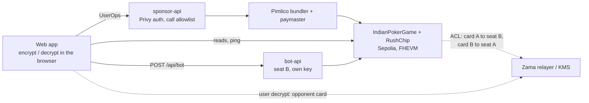

# Blind Bluff

> Your card is shown to your opponent and hidden from you. Read their bets, not your hand.

Heads-up Indian poker on the **Zama Protocol (FHEVM)**. Each player's card is encrypted on-chain and readable by the
**opponent only**; nobody sees their own card, and the operator and the validators see neither. A showdown publishes
a single bit (who won), never a card. Built for the Zama Developer Program Season 5 "Confidential Gaming" track.

> **This project is not audited, endorsed or operated by Zama. Use at your own risk.**

## Why it needs FHE

If the cards were plain on-chain state, anyone could read both hands and the game would be over. A trusted dealer
server would work, but then the dealer can peek, leak or cheat. Here the deal, the comparison and the payout run on
encrypted values and no party, including the bot's operator, can read the bot's own card.

## How to play

- One hand per table, two players, 2 RUSH deposited each (ante 1 + one possible bet of 1). Unused chips come back.
- A random card from 1 to 13 is dealt to each seat, both different. You see **your opponent's** card, not yours.
- Betting is Kuhn-style, no raises: the first player checks or bets; facing a bet you call or fold; if the first
  player checks, the second may check (showdown) or bet, and then the first calls or folds.
- A fold or a timeout (45 s per move) ends the hand and the other player wins. Otherwise the higher card wins the pot.
- Play a friend by sharing the table link, take an open table from the lobby, or play the bot.

**Public:** player addresses, betting history, timing, who won, whether deposits were paid.
**Private:** both cards, every chip balance. Details: [docs/privacy-summary.md](docs/privacy-summary.md).

## Layout

| Path | What |
| --- | --- |
| `packages/contracts` | Hardhat 2 + FHEVM. `RushChip` (ERC-7984 chip + faucet + owner mint), `IndianPokerGame` |
| `apps/web` | Vite + React mobile-first UI (viem + `@zama-fhe/sdk`, Privy login, ERC-4337 smart account), offline demo mode |
| `apps/sponsor-api` | Vercel function: Privy-authenticated, validated JSON-RPC proxy to Pimlico (gas sponsorship) |
| `apps/bot-api` | Vercel function: advances the bot one step per call (decrypts the opponent's card, bets) |
| `docs/` | Deployment guide, privacy summary, gate result, design and plan |

## Architecture



- **Deal:** the second player's `joinTable` draws two distinct cards with `FHE.randEuint64` and grants each card to
  the *other* seat through the ACL. Cards are never made publicly decryptable.
- **Settlement:** a showdown computes `FHE.gt(cardA, cardB)` and makes only that bit publicly decryptable. Anyone
  submits the decryption proof; `FHE.checkSignatures` verifies it. Deposits are confirmed in the background.
- **Gasless play:** the Privy wallet owns an ERC-4337 smart account; `apps/sponsor-api` validates every call before
  forwarding it to Pimlico. The Pimlico key never reaches the browser.
- **Bot:** a table reserved for the bot's address. The browser pings `apps/bot-api`, which decrypts the human's card
  (the rule gives the opponent that view) and acts. The bot's own card is hidden from the bot and from its operator.

## Run it

Prerequisites: [bun](https://bun.sh) and Node.js 20 or newer.

```bash
bun install
bun run test            # contract tests on the mock FHEVM
bun run dev             # web app; shows an offline demo until contracts are configured
```

Force the offline demo with `VITE_DEMO_MODE=true`. In demo mode a built-in bot sits at every table and nothing is
encrypted.

**Local end-to-end hand** (two terminals):

```bash
cd packages/contracts && bunx hardhat node
cd packages/contracts && bun run smoke:poker:local   # expects "OK: full hand verified"
```

**Sepolia:** see [docs/deployment.md](docs/deployment.md) for keys, deploy, smoke test, web, sponsor and bot setup.
The live web client needs `apps/web/src/contracts/deployment.sepolia.json` with non-zero addresses (`deploy:sepolia`
writes it). Without the Privy values you can play with an injected wallet that has Sepolia ETH.

### Measured on Sepolia

One full hand between two accounts (`bun run smoke:poker:sepolia`): `joinTable` with the deal 11.7 s, opponent-card
decrypt 3-7 s, one betting move about 12 s, result decrypt plus `finalizeShowdown` 13.0 s. Full table in
[docs/season5-gate-result.md](docs/season5-gate-result.md).

## PWA cache policy

Only the app shell and fonts are cached (`apps/web/src/sw.ts`). Ethereum RPC, relayer/KMS, wallet traffic and every
non-GET request go straight to the network, and no decrypted value is stored. Offline, the game is not playable.
