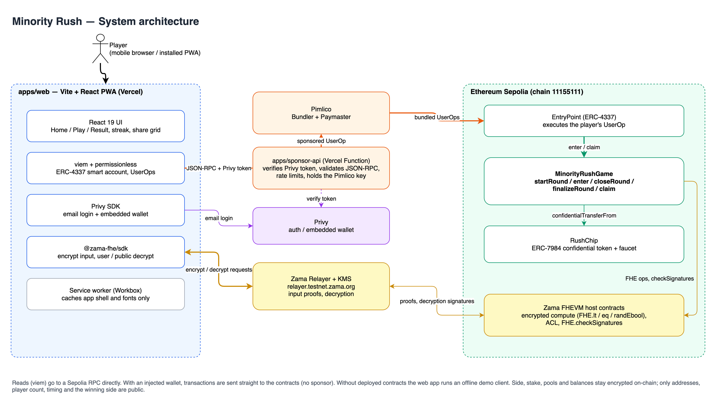

# Minority Rush

> One choice. One secret stake. Outsmart the crowd.

Pick **Sun** or **Moon** and stake chips. Both are encrypted on-chain with the Zama Protocol (FHEVM). After the
deadline the contract compares the encrypted pools, and the side with the **smaller total stake wins 2× its stake**.
A tie is broken by on-chain encrypted randomness (`FHE.randEbool`). On a transparent chain, late joiners could see the
pools and always pick the minority, so the game only works because the state stays encrypted.

> **This project is not audited, endorsed or operated by Zama. Use at your own risk.**

## Layout

| Path | What |
| --- | --- |
| `packages/contracts` | Hardhat 2 + FHEVM. `RushChip` (ERC-7984 chip + faucet), `MinorityRushGame` |
| `apps/web` | Vite + React mobile-first UI (viem + `@zama-fhe/sdk`, Privy login, ERC-4337 smart account) |
| `apps/sponsor-api` | Vercel function: Privy-authenticated, validated JSON-RPC proxy to Pimlico (gas sponsorship) |
| `docs/` | Concept doc and UI mockup |

## Architecture



Editable source: [docs/architecture.drawio](docs/architecture.drawio) (open in draw.io; re-export with
`drawio -x -f png -s 2 -b 20 -o docs/architecture.png docs/architecture.drawio`).

- **Web app (`apps/web`)** encrypts the side and stake in the browser with `@zama-fhe/sdk` (input proofs and decryption
  go through the Zama Relayer) and signs with either an injected wallet or a Privy embedded wallet.
- **Gasless play:** the Privy wallet owns an ERC-4337 smart account. The web app sends JSON-RPC to
  `apps/sponsor-api`, which verifies the Privy token, validates the request and forwards it to Pimlico (bundler and
  paymaster). The Pimlico key never reaches the browser.
- **Contracts (Sepolia):** `MinorityRushGame` does the encrypted comparison through the FHEVM host contracts and takes
  stakes from `RushChip` (ERC-7984) with `confidentialTransferFrom`.
- Reads go straight to a Sepolia RPC. With no deployed addresses the web app falls back to an offline demo client.

## Tech stack

| Area | Technology |
| --- | --- |
| Confidential compute | Zama Protocol (FHEVM): `@fhevm/solidity`, `@zama-fhe/relayer-sdk`, OpenZeppelin `confidential-contracts` (ERC-7984) |
| Contracts | Solidity 0.8.27 (EVM cancun), Hardhat 2 + `@fhevm/hardhat-plugin`, ethers 6, TypeChain, Mocha / Chai, solhint |
| Web | React 19, Vite 8, TypeScript 7, viem 2, `@zama-fhe/sdk`, zod, vite-plugin-pwa (Workbox), Vitest, oxlint |
| Auth and gasless | Privy (`@privy-io/react-auth`, `@privy-io/node`), ERC-4337 via `permissionless`, Pimlico bundler / paymaster |
| Backend | Vercel Function (`apps/sponsor-api`, TypeScript, zod, Vitest) |
| Hosting | Vercel (web and sponsor API as separate projects) |
| Chain | Ethereum Sepolia (11155111); local development uses the Hardhat mock FHEVM |
| Tooling | bun workspaces (Node 20+; 24 used locally), draw.io CLI for the architecture diagram |

## Round flow

Rounds follow a fixed daily schedule with four deadlines (UTC seconds-of-day `[10800, 32400, 43200, 50400]`, i.e.
JST 12:00, 18:00, 21:00 and 23:00). Each deadline has a 90-minute window before it in which a round can be started.

1. `startRound()` → anyone, only inside one of those 90-minute windows. A round still closing or awaiting `finalizeRound`
   does not block the next start.
2. `enter(roundId, encSide, encStake, proof)` → pulls chips via ERC-7984 `confidentialTransferFrom` (the player first
   calls `setOperator(game, until)`); credits the amount **actually transferred**. Stake is clamped to 1–10. 3–100 players.
3. `closeRound()` → after the deadline (anyone): `FHE.lt` / `FHE.eq` / `FHE.randEbool` pick the winner, which is made
   publicly decryptable. Fewer than 3 players → round cancelled, stakes refunded.
4. `finalizeRound(roundId, moonWon, proof)` → anyone submits the decryption proof; `FHE.checkSignatures` verifies it.
5. `claim(roundId)` → each player receives an encrypted payout (2× stake or 0) and can decrypt only their own result.

**Public:** addresses, player count, timing, final winning side. **Private:** each side, stake, reward, balance, pools.

The faucet gives 20 chips once per 24 hours per address. The web Home screen shows the countdown to the next deadline,
the daily streak (one freeze earned every 7th consecutive day, at most one stored) and a share grid of recent results.

## Run it

Prerequisites: [bun](https://bun.sh) and Node.js 20 or newer.

**1. Local, no keys needed**

```bash
bun install --cwd packages/contracts && bun install --cwd apps/web
bun run test            # 22 contract tests on the mock FHEVM
bun run dev             # web app; runs an offline demo until contracts are deployed
```

Optional full-round check on a local node (two terminals):

```bash
cd packages/contracts && bunx hardhat node        # terminal A
cd packages/contracts && bun run smoke:local      # terminal B, expects "OK: full round verified"
```

**2. Against Sepolia (live client)**

The web app switches to the live client once `apps/web/src/contracts/deployment.sepolia.json` holds non-zero
addresses (it does after `deploy:sepolia`). Set these in `apps/web/.env.local` (see `apps/web/.env.example`):
`VITE_SEPOLIA_RPC_URL`, plus `VITE_PRIVY_APP_ID`, `VITE_PRIVY_CLIENT_ID` and `VITE_SPONSOR_API_URL` for email login
and gasless play. Without the Privy values you can still play with an injected wallet (needs Sepolia ETH for gas).

Rounds can only be started inside the 90-minute window before a deadline, so run the smoke test then:

```bash
cd packages/contracts && bun run smoke:sepolia   # needs PRIVATE_KEY, PRIVATE_KEY_2, PRIVATE_KEY_3 funded with Sepolia ETH
```

**3. Sponsor API (gasless play)** runs as a Vercel Function and needs `PRIVY_APP_ID`, `PRIVY_VERIFICATION_KEY`,
`PIMLICO_API_KEY`, `PIMLICO_SPONSORSHIP_POLICY_ID`, `CHIP_ADDRESS`, `GAME_ADDRESS` and `ALLOWED_WEB_ORIGIN`. See
[docs/deployment.md](docs/deployment.md#6-publish-the-web-app-vercel) for deploying it and the web app.

Full step-by-step (keys, deploy, smoke test, verification, checklist): [docs/deployment.md](docs/deployment.md).

Deploy to Sepolia (needs `PRIVATE_KEY`, `INFURA_API_KEY` via `.env` or `npx hardhat vars set`):

```bash
bun run deploy:sepolia   # writes apps/web/src/contracts/deployment.sepolia.json
bun run export:abi
```

Redeploying replaces the contracts: old balances and rounds are abandoned. The redeploy runbook (including setting
`LAUNCH_DAY_KEY` in `apps/web/src/lib/schedule.ts`) is in [docs/deployment.md](docs/deployment.md#redeploy-runbook).

## PWA cache policy

Only the app shell and fonts are cached (`apps/web/src/sw.ts`). Ethereum RPC, relayer/KMS, wallet traffic and every
non-GET request go straight to the network, and no decrypted value is stored. Offline, the game is not playable
(the banner says so and actions are disabled). Updates are applied only when the user taps *Update*.

## MVP scope and honest gaps

Implemented: contracts, tests, wallet (injected) flow, user decryption of balance/reward, public decryption of the
winner, installable PWA (manifest, icons, service worker, install hint after a round, offline banner that pauses
actions, prompt-style updates) and an Etherscan verify link on the result screen. **Implemented but not yet run with real credentials:**
Privy email login, ERC-4337 smart account and Pimlico gas sponsorship (see [docs/gasless.md](docs/gasless.md)).
**Not yet:** Lism CSS, Sepolia deployment and E2E run,
`confidentialTransferAndCall` entry (we use operator + `confidentialTransferFrom`). The live client has not been run
against Sepolia yet; only the mock-FHEVM contract tests and the offline demo UI were exercised. The service worker
builds and passes a syntax check, but could not be exercised at runtime in the dev browser pane (no SW support there);
check install/offline in Chrome and Safari before shipping.

Known gaps from review:

- "See result" and payout claiming cover only the latest round. If a newer round started before the player returns,
  an earlier settled round's payout is not offered for claim (its squares still show won/lost).
- The live Home shows a "Free play" placeholder until the schedule loads, and shows no error if the RPC keeps failing.
- The live scheduled paths were exercised only by contract tests, the local smoke run and a demo-mode browser run,
  never against Sepolia.
- Real close→finalized latency and gas with 100 players are unmeasured (see "Measured on Sepolia" in
  [docs/deployment.md](docs/deployment.md)).
